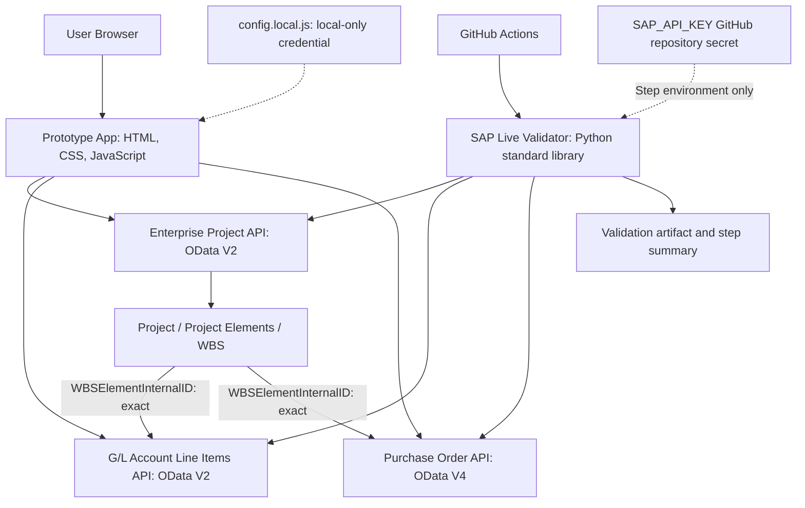

# Architecture

## Technology Stack

The current assignment prototype intentionally uses HTML, CSS, vanilla JavaScript and browser `fetch()` with SAP Business Accelerator Hub Sandbox APIs. Git/GitHub support collaboration; GitHub Actions and Python's standard library provide remote integration validation.

There is **no frontend framework, npm/build process or application backend**. A local static preview is optional hosting of the same files, not a proxy/backend. The simple stack isolates SAP connectivity and evidence interpretation before later architecture choices. It is not a production credential/security architecture.

## Architecture Diagram



The WBS arrows describe logical joins, **not SAP API-to-API calls**. The browser and validator independently make read-only requests. **WBSElementInternalID is the preferred primary cross-API link**; WBS matching remains exact. Numeric-only ProjectInternalID leading-zero equivalence is limited to the secondary G/L fallback. Raw SAP identifiers are retained.

## Application Structure and State

- `index.html` loads local/configuration scripts, core state/utilities, HTTP and API services, UI renderers, then `app.js`, all as normal deferred scripts. No ES modules are used; preserve the dependency order in [UI Contract](UI_CONTRACT.md).
- `api-config.js` exposes separate `SAP_API_CONFIG`, `GL_API_CONFIG` and `PO_API_CONFIG` objects. It contains endpoints/selected fields, not credentials.
- `window.DPEApp` is the shared runtime namespace. Modules use private closures rather than introducing additional globals. Existing configuration objects remain unchanged.
- `js/core/state.js` owns runtime records, selected project and request controllers/sequence IDs. `js/core/utils.js` owns date/flag/identifier helpers and existing exact decimal arithmetic.
- `js/services/sap-http.js` owns fetch headers, timeout, safe response processing and HTTP metadata. API services retain explicit OData V2 versus V4 interpretation, joins and financial/procurement summary semantics; they never render DOM.
- `js/ui/renderers.js` owns existing DOM hooks, tables, status/error/debug areas and display of service-provided summary lines. It does not fetch data, contain SAP endpoints/credentials or make continuation decisions.
- `app.js` is now the orchestration/controller layer: user actions → state/reset/cancellation → service calls/results → UI. Event callbacks are coordinated here and bound through the UI layer.
- The page first retrieves up to five projects. Selecting one loads its elements and retains WBS IDs. Separate buttons load G/L and PO evidence; they are not automatically loaded on selection.
- Selecting/reloading a project clears prior financial/procurement evidence. Request cancellation and request IDs prevent stale responses from populating a different project's panels.
- Full accepted records remain in memory; raw/debug areas show safe responses separately. There is no application persistence or stored decision record. Reloading the page loses current selection/evidence state.
- G/L/PO queries are limited to 100 returned rows per linked request. There is no automatic pagination; continuation warnings mean counts/amounts are not complete-project totals.

UI contributors primarily work in `styles.css`, `index.html` and `js/ui/`; integration contributors primarily work in `js/services/` and `api-config.js`. Coordinate shared `js/core/` changes because all layers depend on them. These are collaboration boundaries, not exclusive ownership restrictions. Requirement contributors still validate the journey against the context/scope. See [CONTRIBUTING.md](../CONTRIBUTING.md).

## Data Responsibility

| Source | Responsibility |
| --- | --- |
| SAP evidence, available now where samples join | Project identity/lifecycle, Project Elements/WBS, financial postings and procurement account assignments. These are real Sandbox samples, not DPE production records. |
| Future DPE governance evidence, not implemented yet | Review/gate configuration, strategic alignment, benefit outlook, risks/dependencies, rationale/actions and accountable human decision. |

Future human-entered or prototype-local governance information must be labelled separately, **not represented as SAP data**. Missing milestones/PO joins cannot be filled with fake SAP records. AI, if added later, supports evidence synthesis rather than making the final continuation decision.

## OData Versions

| API | Collection shape |
| --- | --- |
| Enterprise Project | OData V2 → `data.d.results` |
| G/L Account Line Items | OData V2 → `data.d.results` |
| Purchase Order | OData V4 → `data.value` |

The validator retains separate V2/V4 collection checks over shared HTTP/JSON transport. It supports the existing gzip/deflate and UTF-8 BOM handling. Do not assume one collection parser works for every SAP API. [API Integration](API_INTEGRATION.md) documents endpoints and join semantics.

## Security Boundary

**Local:** the browser key lives only in ignored/untracked `config.local.js`, copied from the safe example. It is accessible to that browser and its developer tools, so it is not a true server-side secret. Do not deploy/share the page with a real key.

**CI:** GitHub Actions passes repository secret `SAP_API_KEY` only to the validation step's environment. The script never reads `config.local.js`. Reports exclude keys, credential headers and complete raw payloads; exact-key redaction occurs before output, and HTTP redirects are blocked. Neither credential belongs in tracked repository content, screenshots or PRs.

Remote SAP validation proves API connectivity/joins, not browser CORS or UI correctness. A separate **Frontend Static Checks** workflow now runs on PRs into `master` and manual dispatch, without secrets or SAP calls. It checks the HTML/script contract and JavaScript/Python syntax, not runtime behaviour. It does not change the existing SAP live workflow, configure branch protection or impose an automated approval rule.

## Repository Tree

The tree below includes the local-only configuration explicitly; a fresh clone will not contain that ignored file. `.git/` is omitted.

```text
.
├── .github/
│   ├── workflows/
│   │   ├── sap-live-validation.yml
│   │   └── static-checks.yml
│   ├── PULL_REQUEST_TEMPLATE.md
│   └── sap-validation-trigger
├── api/
│   ├── API_ENTERPRISE_PROJECT_SRV_0002.json
│   ├── API_GLACCOUNTLINEITEM.json
│   ├── CE_PURCHASEORDER_0001.json
│   └── CE_PURCHASEREQUISITION_0001.json
├── docs/
│   ├── ARCHITECTURE.md
│   ├── API_INTEGRATION.md
│   ├── MVP_SCOPE.md
│   └── UI_CONTRACT.md
├── js/
│   ├── core/
│   │   ├── state.js
│   │   └── utils.js
│   ├── services/
│   │   ├── sap-http.js
│   │   ├── project-service.js
│   │   ├── gl-service.js
│   │   └── po-service.js
│   └── ui/
│       └── renderers.js
├── scripts/
│   ├── check_frontend_contract.py
│   └── sap_live_validate.py
├── .gitignore
├── api-config.js
├── app.js
├── config.example.js
├── config.local.js                 # local-only, ignored/untracked
├── CONTRIBUTING.md
├── DECISIONS.md
├── FIRST_OPENCODE_PROMPT.md
├── index.html
├── PROJECT_CONTEXT.md
├── README.md
└── styles.css
```

`api/` holds read-only downloaded specifications; `docs/` explains engineering/scope/contracts; `.github/` holds static/live workflows and review infrastructure; `scripts/` holds structural and remote checks; `js/` holds the separated runtime layers. Root `app.js` coordinates the browser app. `FIRST_OPENCODE_PROMPT.md` is historical bootstrap material, not permission to rerun setup or override current decisions/contribution rules.

Runtime `validation-report.json` and `validation-summary.md` are generated outputs, not committed source files. The workflow uploads them as artifacts; do not add them or generated bytecode to a routine PR.
