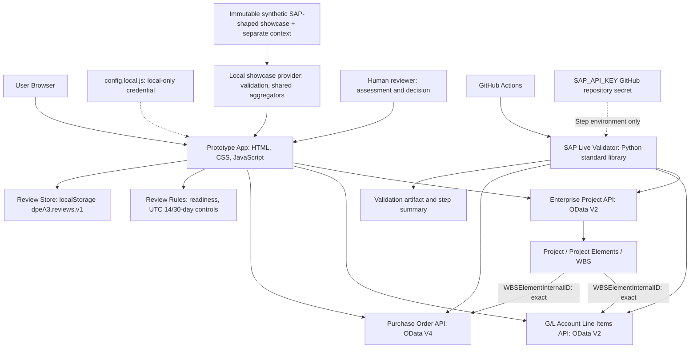

# Architecture

## Technology Stack

The current assignment prototype intentionally uses HTML, CSS, vanilla JavaScript and browser `fetch()` with SAP Business Accelerator Hub Sandbox APIs. Git/GitHub support collaboration; GitHub Actions and Python's standard library provide remote integration validation.

There is **no frontend framework, npm/build process or application backend**. A local static preview is optional hosting of the same files, not a proxy/backend. The simple stack isolates SAP connectivity and evidence interpretation before later architecture choices. It is not a production credential/security architecture.

## Architecture Diagram



The WBS arrows describe logical joins, **not SAP API-to-API calls**. The browser and validator independently make read-only requests. **WBSElementInternalID is the preferred primary cross-API link**; WBS matching remains exact. Numeric-only ProjectInternalID leading-zero equivalence is limited to the secondary G/L fallback. Raw SAP identifiers are retained.

## Application Structure and State

- `index.html` loads local/configuration scripts, core state/utilities, HTTP and API services, UI renderers, then `app.js`, all as normal deferred scripts. No ES modules are used; preserve the dependency order in [UI Contract](UI_CONTRACT.md).
- `api-config.js` exposes separate `SAP_API_CONFIG`, `GL_API_CONFIG` and `PO_API_CONFIG` objects. It contains endpoints/selected fields, not credentials.
- `window.DPEApp` is the shared runtime namespace. Modules use private closures rather than introducing additional globals. Existing configuration objects remain unchanged.
- `js/core/state.js` owns runtime SAP records, selected project, active view/review, concise evidence state and request controllers/sequence IDs. `js/core/utils.js` owns date/flag/identifier helpers and existing exact decimal arithmetic. `js/core/review-rules.js` owns assessment/outcome enums, deterministic readiness and UTC calendar-day timing; it does not recommend an investment decision.
- `js/services/sap-http.js` owns fetch headers, timeout, safe response processing and HTTP metadata. API services retain explicit OData V2 versus V4 interpretation, joins and financial/procurement summary semantics; they never render DOM.
- `js/ui/renderers.js` retains SAP tables/status/error/debug areas. `js/ui/governance.js` owns desktop navigation, dashboard/review projections, assessment/summary/decision forms and confirmation. Neither UI module fetches SAP or makes continuation decisions.
- `js/services/review-store.js` owns versioned local prototype storage. It whitelists project identity, human inputs, system timestamps and concise evidence summaries, and rejects edits to completed records. It stores no full raw SAP transactions, request headers or credentials. Exact local credential text is redacted if accidentally pasted into input.
- `js/services/governance-directory.js` owns immutable, validated fictional owner configuration. It is immediately available without fetch or a SAP header, including file-page loads. These are PROTOTYPE GOVERNANCE DIRECTORY roles, not SAP/DPE personnel or authenticated authority.
- `js/data/showcase-portfolio.js` exposes immutable `window.DPE_SHOWCASE_PORTFOLIO`: API-specific raw wrappers, separate governanceContexts and seed definitions. It is normal deferred JS, not fetched JSON; raw records have no scenario/budget/source extensions.
- `js/services/showcase-service.js` validates the selected field/type/length/date subset, exact references and seeds before serving a local provider result. It shares `services.gl.aggregate()/summarize()` and `services.po.aggregate()/summarize()` with the live path, never calls a network or needs a key. Only this provider exposes explicit synthetic approved/forecast context; live projects receive no invented metrics.
- `app.js` is now the orchestration/controller layer: user actions → state/reset/cancellation → service calls/results → UI. Event callbacks are coordinated here and bound through the UI layer.
- Startup synchronously validates/renders five showcase projects, ensures missing seed records, then retrieves up to five live projects when a key exists. Merge by unique UUID, showcase first; failed live refresh keeps showcase usable. Opening an investment automatically loads structure, then financial/procurement evidence through the appropriate provider. Refresh/retry remain secondary, never an automatic retry loop.
- Selecting/reloading a project clears prior financial/procurement evidence. Request cancellation and request IDs prevent stale responses from populating a different project's panels.
- Full accepted SAP records/raw views remain in memory. Reviews and completed decisions persist in this browser/origin under `dpeA3.reviews.v1`; page reload loses live table payloads but allows resuming reviews/viewing labelled captured evidence summaries. Completed decision snapshots are not changed by later SAP loads. Storage unavailable/malformed/full states are reported without claiming a successful save or silently overwriting malformed data.
- G/L/PO queries are limited to 100 returned rows per linked request. There is no automatic pagination; continuation warnings mean counts/amounts are not complete-project totals.

UI contributors primarily work in `styles.css`, `index.html` and `js/ui/`; integration contributors primarily work in `js/services/` and `api-config.js`. Coordinate shared `js/core/` changes because all layers depend on them. These are collaboration boundaries, not exclusive ownership restrictions. Requirement contributors still validate the journey against the context/scope. See [CONTRIBUTING.md](../CONTRIBUTING.md).

## Data Responsibility

| Source | Responsibility |
| --- | --- |
| SAP evidence, available now where samples join | Project identity/lifecycle, Project Elements/WBS, financial postings and procurement account assignments. These are real Sandbox samples, not DPE production records. |
| REVIEWER INPUT | Review basis, strategic alignment, benefits, delivery, cost-position judgement, risk, future value, comments/dependencies, decision/rationale/owners/actions/next review. These are explicitly not SAP fields. |
| SYSTEM CALCULATED | Review/decision timestamps and record IDs, counts/readiness, 14-day target and 30-day threshold/status, grouped amounts from returned SAP rows. No weighted score or recommendation. |

Human/prototype governance information is source-labelled, **not represented as SAP data**. Separate SHOWCASE transactions are schema-shaped synthetic examples, not fallback data for live projects. Missing live milestones/PO joins are never filled with showcase rows. One product, no Demo/Live modes. AI remains deferred; humans select the five A2 outcomes and SAP project status is never written back.

## Playable Review Workflow

Dashboard / Portfolio are the only primary destinations. Investment → Review → Assessment → Summary → Human Decision → immutable Decision Record remains a workflow. Incomplete active reviews resume Assessment; ready ones resume Summary via Review & Decide, never directly Decision. Recorded decisions open Confirmation. Dashboard's first four lenses use current open records/unchanged rules; its fifth counts all decision_recorded records without investment deduplication, sorted by decision timestamp descending and ID tie break. The same list switches columns; there is no standalone Decisions page or secondary recent-decision list. Portfolio governance state is derived, not persisted. Investment Detail history includes every completed cycle for that investment. Existing store.start supports new cycles after completion and reuses an active review; update/confirm reject completed records. Non-Stop completion permits Start New Review; latest Stop has no normal restart UI and is guarded in the controller. Next Review is a human checkpoint, not a timer or automatic review.

The controller retains a transient freshly-recorded review ID only for the current Confirmation visit. Back to Dashboard consumes it to select Recorded Decisions; ordinary navigation, historical record opening and return to Investment clear it. Dashboard nav always resets Active Reviews, including when already on Dashboard. Periodic rendering preserves the chosen lens; reload does not. No route/filter preference or new business state is persisted.

Terminal Stop is also enforced inside reviewStore.start(), selecting the latest completed decision by actual timestamp/ID tie break rather than review-open date. It rejects a normal start for that investment (UUID case-insensitive) before returning/creating an active review. New Stop confirmations omit nextReviewDate; old immutable records are not migrated or rewritten. Current presentation suppresses a previous cycle’s Next Review whenever an active review exists. These are local domain guards, not authentication or tamper-proof server enforcement.

Opening a review creates its real browser timestamp once; resuming does not reset it. One active review per project is reused; subsequent completed review rounds retain history. Assessment/draft changes save locally. READY requires context, successfully loaded lifecycle, attempted G/L/PO, selected basis, all six assessed categories and a decision owner. Technical failures/unavailable attempts remain explicit, not successful/zero SAP results. Readiness is completeness, not evidence quality; current evidence requests must finish before decision confirmation.

Targets are opened timestamp +14/+30 UTC calendar days. Status is calculated using the browser clock and refreshed periodically; no external escalation or reminder is sent. Conditional/Modify/Pause outcomes require action/owner/next date. Every decision requires an outcome, rationale and owner; no decision is preselected. Saving revalidates readiness/fields in the store, captures assessment/evidence/timing and makes the completed record immutable through app APIs.

LocalStorage is not authenticated, shared, encrypted or tamper-proof production storage. Keep the same static-preview origin to resume records; browser clearing/site changes remove access. Saved snapshots are not proof of fresh evidence—reload SAP where appropriate. No backend, database, AI, MCP or production role/approval enforcement is added.

### Product controls and owner compatibility

Owner is selected only in Assessment and displayed read-only on Decision. The store resolves ID against immutable JS configuration rather than trusting a second text field. `decisionOwnerId`/`decisionOwnerSnapshot` and decision `ownerId`/`ownerSnapshot` retain the `dpeA3.reviews.v1` namespace and legacy text. Reads normalise old trigger wording without rewriting storage; later normal writes use canonical terminology. Completed legacy owners keep historic text; open legacy reviews require explicit eligible selection before a new decision, without name inference. Action Owner remains free text.

`reviewStore.seedShowcase()` adds only missing stable seeds, never overwriting an existing edited/completed ID or creating a duplicate active review. The same API with explicit reset removes only records whose project UUID is registered in the showcase provider; the UI first requires native confirmation. All unrelated local records remain; malformed storage fails without overwrite. The historical Stop uses the normal completed record/snapshot structure. Sources are recorded separately (`SHOWCASE` / `SAP SANDBOX`; showcase scenario or reviewer input; calculated controls). Fixed seed times remain historical; normal user-created records retain actual times. Reset does not alter configuration or loaded live projects.

Native radios in fieldsets expose assessment/outcome choices with original stored strings and explicit unassessed/no-decision defaults. Review Trigger is a callout for existing reviewBasis, not an inferred event. Existing reviewSignals/timing drive Needs Attention for open reviews only. Progressive disclosure retains limitations/raw records below concise evidence summaries; no new risk threshold or recommendation is introduced.

### Responsibility Management exploration

Semantic fit for production team/function-based authority is high. The separate remote Sandbox/APIKey probe returned HTTP 500/unavailable; it is not called by the browser or required for owner selection. The probe stays non-gating. Reports may contain schema keys/counts/status but no personal/member sample values. Main Enterprise Project/G/L/PO validation is preserved.

## OData Versions

| API | Collection shape |
| --- | --- |
| Enterprise Project | OData V2 → `data.d.results` |
| G/L Account Line Items | OData V2 → `data.d.results` |
| Purchase Order | OData V4 → `data.value` |

The validator retains separate V2/V4 collection checks over shared HTTP/JSON transport. It supports the existing gzip/deflate and UTF-8 BOM handling. Do not assume one collection parser works for every SAP API. [API Integration](API_INTEGRATION.md) documents endpoints and join semantics.

## Security Boundary

**Local:** the browser key lives only in ignored/untracked `config.local.js`, copied from the safe example. It is accessible to that browser and its developer tools, so it is not a true server-side secret. Do not deploy/share the page with a real key.

**CI:** GitHub Actions passes repository secret `SAP_API_KEY` only to the validation step's environment. The script never reads `config.local.js`. Reports exclude keys, credential headers and complete raw payloads; exact-key redaction occurs before output, and HTTP redirects are blocked. Neither credential belongs in tracked repository content, screenshots or PRs.

Remote SAP validation proves API connectivity/joins, not browser CORS or UI correctness. **Frontend Static Checks** runs on PRs and pushes to `master`, plus manual dispatch, without secrets or SAP calls. It checks the HTML/script contract, JavaScript/Python syntax and credential-free logic/controller/presentation/schema regressions. It cannot certify browser rendering or live API behaviour. The SAP live workflow remains unchanged.

## Repository Tree

The tree below includes the local-only configuration explicitly; a fresh clone will not contain that ignored file. `.git/` is omitted.

```text
.
├── .github/
│   ├── workflows/
│   │   ├── sap-live-validation.yml
│   │   └── static-checks.yml
│   ├── PULL_REQUEST_TEMPLATE.md
│   └── sap-validation-trigger
├── api/
│   ├── API_ENTERPRISE_PROJECT_SRV_0002.json
│   ├── API_GLACCOUNTLINEITEM.json
│   ├── CE_PURCHASEORDER_0001.json
│   └── CE_PURCHASEREQUISITION_0001.json
├── docs/
│   ├── ARCHITECTURE.md
│   ├── API_INTEGRATION.md
│   ├── MVP_SCOPE.md
│   └── UI_CONTRACT.md
├── js/
│   ├── core/
│   │   ├── state.js
│   │   ├── utils.js
│   │   └── review-rules.js
│   ├── data/
│   │   └── showcase-portfolio.js
│   ├── services/
│   │   ├── sap-http.js
│   │   ├── project-service.js
│   │   ├── gl-service.js
│   │   ├── po-service.js
│   │   ├── governance-directory.js
│   │   ├── showcase-service.js
│   │   └── review-store.js
│   └── ui/
│       ├── renderers.js
│       └── governance.js
├── scripts/
│   ├── check_frontend_contract.py
│   └── sap_live_validate.py
├── tests/
│   ├── helpers/
│   │   └── workspace.js
│   ├── productisation.test.js
│   ├── customer-workflow.test.js
│   ├── decision-handover.test.js
│   ├── review-feedback.test.js
│   ├── visual-components.test.js
│   ├── showcase-fixtures.test.js
│   ├── showcase-portfolio.test.js
│   └── ui-presentation.test.js
├── .gitignore
├── api-config.js
├── app.js
├── config.example.js
├── config.local.js                 # local-only, ignored/untracked
├── CONTRIBUTING.md
├── DECISIONS.md
├── DESIGN.md
├── index.html
├── PROJECT_CONTEXT.md
├── premium-ui.json
├── README.md
└── styles.css
```

`api/` holds read-only downloaded specifications; `docs/` explains engineering/scope/contracts; `.github/` holds static/live workflows and review infrastructure; `scripts/` holds structural and remote checks; `js/` holds the separated runtime layers. Root `app.js` coordinates the browser app. Obsolete bootstrap/old visual-verification artefacts have been removed; current runtime and tests are the handover baseline.

Runtime `validation-report.json` and `validation-summary.md` are generated outputs, not committed source files. The workflow uploads them as artifacts; do not add them or generated bytecode to a routine PR.
